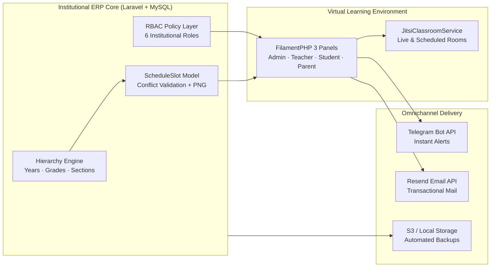

<div align="center">

<a href="https://montly.space">
  
</a>

<br />

<a href="https://montly.space">
  
</a>

<p align="center">
  <a href="https://montly.space"></a>
  
  
  
  
  
</p>

<p align="center">
  <a href="https://montly.space"><strong>Live Platform</strong></a> ·
  <a href="#architecture--modules"><strong>Architecture</strong></a> ·
  <a href="#role-based-access-control-rbac"><strong>RBAC Matrix</strong></a> ·
  <a href="#repository-structure"><strong>Directory Structure</strong></a> ·
  <a href="https://heycriss.dev/montly"><strong>HeyCriss Labs</strong></a>
</p>

</div>

---

## Overview

**Montly LMS** combines a **Learning Management System (LMS)** with an institutional **School ERP**. It centralizes academic administration, conflict-free schedule generation, live virtual classrooms, grading workflows, and omnichannel alerts across administrators, teachers, students, and parents/guardians in real time.

> **Resumen en Español:** **Montly LMS** fusiona una plataforma educativa tipo LMS con un ERP escolar moderno para centralizar horarios, evaluaciones, aulas virtuales con Jitsi Meet y alertas omnicanal (Telegram Bot y Resend API) bajo un control de acceso estricto basado en roles (RBAC).

<br />

<div align="center">
  
</div>

---

## Architecture & Modules

### 1. Institutional Analytics & Hierarchical ERP
- **Visual Dashboards:** Real-time metrics for academic performance, attendance, and grading distribution built on FilamentPHP.
- **Conflict-Free Schedule Builder:** Automated overlap detection across teachers, classrooms, and sections (`App\Models\ScheduleSlot::hasConflict()`), with branded PNG export.
- **Hierarchical Data Model:** Adapts to any school structure (`School Years → Grades → Sections → Classrooms → Subjects`).

### 2. Virtual Learning Environment
- **Native Jitsi Meet Classrooms:** Role-gated live and scheduled video sessions (`App\Services\JitsiClassroomService`).
- **Courses & Evaluations:** Rich-text syllabus, availability windows, assignment submissions, grading rubrics, and audit history.
- **Parent / Guardian Portal:** Read-only real-time view covering student attendance, grades, pending tasks, and school calendar events.

### 3. Omnichannel Automation & Infrastructure
- **Instant Alerts:** Automated notifications dispatched via **Telegram Bot** (`App\Services\OmnichannelNotifier`) and transactional emails via **Resend API**.
- **Cloud & Local Storage:** Automated backups and media storage compatible with S3-compliant buckets or local disks.
- **Progressive Web App (PWA):** Installable mobile and desktop experience (`public/manifest.json`).

---

## Role-Based Access Control (RBAC)

Montly enforces strict role isolation (`App\Enums\RoleType`) across every route and Filament resource:

| Role | Access Level | Primary Responsibilities |
| :--- | :---: | :--- |
| **Administrator** (`admin`) | `Full` | ERP configuration, academic hierarchy, global reports, and user management. |
| **Teacher** (`teacher`) | `Moderate` | Subject management, grading, assignment creation, and Jitsi classroom moderation. |
| **Student** (`student`) | `Basic` | Course material access, assignment uploads, grade tracking, and live classes. |
| **Parent / Guardian** (`guardian`) | `Read-Only` | Real-time monitoring of student progress, grades, and institutional calendar. |
| **Alumni** (`alumni`) | `Historical` | Read access to historical academic records and graduation certificates. |
| **Support** (`support`) | `Technical` | System activity monitoring, audit log inspection, and incident resolution. |

---

## System Flow



---

## Repository Structure

```text
montly-lms/
├── app/
│   ├── Enums/
│   │   └── RoleType.php                 # 6-role RBAC enum & permission helpers
│   ├── Models/
│   │   └── ScheduleSlot.php             # Schedule model with overlap conflict detector
│   └── Services/
│       ├── JitsiClassroomService.php    # Role-gated Jitsi Meet room generator
│       └── OmnichannelNotifier.php      # Telegram Bot & Resend notification service
├── assets/
│   ├── github-hero.svg                  # Animated editorial repository hero banner
│   └── github-features-bento.svg        # Animated 6-card Bento specification grid
├── config/
│   └── montly.php                       # Hierarchy, RBAC, Jitsi, and alert settings
├── database/
│   └── migrations/
│       └── 2026_01_01_000001_create_montly_hierarchy_tables.php
├── public/
│   └── manifest.json                    # Progressive Web App (PWA) manifest
├── .env.example                         # Environment configuration template
├── composer.json                        # PHP 8.1+, Laravel 11 & FilamentPHP 3 manifest
└── LICENSE                              # GPL-2.0-or-later
```

---

## Quick Start

```bash
git clone https://github.com/heycriss/montly-lms.git
cd montly-lms
composer install
cp .env.example .env
php artisan key:generate
php artisan migrate
```

---

## License

Released under the **GNU General Public License v2.0 or later (`GPL-2.0-or-later`)**.

<div align="center">
  <br />
  <p>Engineered by <strong><a href="https://heycriss.dev">Cristhian (Criss) · HeyCriss Labs</a></strong> · <a href="https://montly.space"><code>montly.space</code></a></p>
</div>
